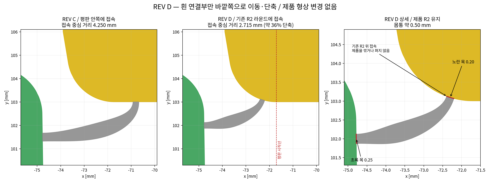

# 알루미늄 연결 압출품 — REV D

제품 형상을 유지하고 흰 연결부만 기존 라운드 가까이 옮긴 짧은 연결부 검토안입니다. **파단 후 디버링·연마·트리밍·절삭 등 후처리는 제외했습니다.** 완전 무자국, 실제 완전 파단, 금형 제작 가능성을 확정한 도면은 아닙니다.

## 최신 자료 다운로드

- [보고서·수정도면·낙하 GIF·계산 자료 전체 ZIP](https://github.com/dltkdghk1103-hue/-/raw/refs/heads/main/downloads/revD_complete_download.zip)
- [REV D 보고서 PDF](https://github.com/dltkdghk1103-hue/-/raw/refs/heads/main/downloads/revD_review_KO.pdf)
- [REV D 수정 DXF](https://github.com/dltkdghk1103-hue/-/raw/refs/heads/main/downloads/short_bridge_revD_CONCEPT.dxf)
- [REV D 도면 PDF](https://github.com/dltkdghk1103-hue/-/raw/refs/heads/main/downloads/short_bridge_revD_CONCEPT.pdf)
- [양끝 완전 분리 후 조건부 낙하 GIF](https://github.com/dltkdghk1103-hue/-/raw/refs/heads/main/downloads/revD_conditional_drop.gif)
- [입력·계산 코드·결과 ZIP](https://github.com/dltkdghk1103-hue/-/raw/refs/heads/main/downloads/revD_results_and_sources.zip)
- [보고서 웹에서 읽기](downloads/revD_review_KO.md)
- [제품 형상 보존 기록](downloads/geometry_preservation_revD.json) · [파일 SHA256](downloads/REV_D_SHA256SUMS.txt)

기존 `report_and_modified_drawings.zip`과 `extrusion_analysis_report_KO.pdf` 주소도 REV D로 갱신했습니다. 파일 화면에서는 **Download raw file** 버튼으로 받을 수 있습니다.

## 이번 변경과 결과

- **위치와 길이:** 노란 접속점을 기존 R2 라운드로 이동했습니다. 접속 중심 거리는 REV C 4.250 → REV D 2.715 mm로 약 36% 감소했습니다. 평판 안쪽으로 깊게 들어가지 않습니다. 최소 제조 가능 길이를 확정한 값은 아닙니다.
- **두께와 파단 순서:** 초록 목 0.25 mm, 노란 목 약 0.20 mm, 몸통 약 0.50 mm입니다. 두 목의 공칭 응력 지표를 약 1% 이내로 맞췄지만 동시 파단을 보장하지 않습니다. 한쪽이 먼저 끊어진 뒤 남은 목에 힘이 전달되는지는 접촉 유지에 달려 있습니다.
- **자중:** 양측 목이 6 m 전 길이에 연속해 남은 조건에서 자중 공칭 응력 지표는 약 0.59 MPa입니다. 냉각 후·T5 후에 자중만으로 끊어질 가능성은 이 근사에서는 낮습니다. 일부만 남은 상태, 고온 유동·인장·크리프·충격은 별도이며 취급 허용하중을 뜻하지 않습니다.
- **내부 낙하:** 두 목이 이미 완전히 분리된 강체 조건의 15개 계산은 모두 내부 바닥 영역에 도달했습니다. 실제 파단 성공률이 아니며, 모든 조건의 안정 정지·같은 최종 위치까지 보장하지 않습니다.
- **자국 / 후처리 없음:** 제품에 숨김 홈이나 단차를 추가하지 않았습니다. 접속띠를 내측에 두어 외부 노출을 줄이는 배치입니다. 제한적인 2D 시야 검사에서는 가려졌지만, 파단 돌기·뜯김·질감 차이와 단부에서의 노출은 미검증입니다. **완전 무자국 요구를 충족했다고 판정하지 않습니다.**

## 제품 형상과 검토 범위

원본 노란색·초록색 제품 DXF 엔티티 4개의 좌표, 원호 bulge, 폭, 열린/닫힌 상태를 저장 후 비교해 동일함을 확인했습니다. 제품에 턱·홈·가이드·돌출부를 추가하지 않았습니다. 기존 목 끝면 표시는 원래 제품 폐곡선을 명시하며, 새 연결부와 겹치는 제품선은 재료 경계이지 절개 틈이 아닙니다. DXF는 금형 와이어 가공용 최종 윤곽도가 아닙니다.

보고서는 탄성 목 단면 비교, 한 목 제거 후 이상화한 접촉 하중 전달, 양끝 분리 후 강체 접촉 계산을 구분합니다. 균열 생성부터 낙하까지 이어지는 손상 해석은 아닙니다. 판 휨을 제외했고, 자유 지지 제품의 편심 타격·기울어짐과 6 m 길이 방향 파단 전파도 검증하지 않았습니다. 손 접촉 폭을 유효 가압 길이로 간주하거나, 사람이 6 m 전 길이를 쉽게 분리할 수 있다고 해석하면 안 됩니다.

0.20 mm 목의 충전성, 다이 지지, 베어링·유속 균형 등 금형 검토가 남아 있습니다. 곡선 피팅은 제작 전 도면 검토 사항이며, 제품 파단 후 후처리를 제안한 것이 아닙니다.

## 이전 자료

[REV B 재검토 / REV C 전체 ZIP](https://github.com/dltkdghk1103-hue/-/raw/refs/heads/main/downloads/revB_revC_complete_download.zip) · [REV C 보고서](https://github.com/dltkdghk1103-hue/-/raw/refs/heads/main/downloads/revB_revC_review_KO.pdf) · [REV C DXF](https://github.com/dltkdghk1103-hue/-/raw/refs/heads/main/downloads/bridge_relocated_revC_CONCEPT.dxf)

[REV B 도면 DXF](downloads/modified_bridge_only_revB_CONCEPT.dxf)와 [이전 정정 보고서](downloads/corrected_report_revB_KO.pdf)는 이력용입니다. REV B의 최신 낙하 판단은 REV B 재검토 / REV C 보고서를 보세요.

**REV A는 철회 상태입니다.** 제품에 안내 턱을 추가하고 제품 목 주변을 변경한 이전 안은 형상 보존과 포개짐 조건에 맞지 않았습니다. 현재 파일 목록에 REV A 도면은 없으며, 이미 받은 REV A는 사용 대상이 아닙니다.
