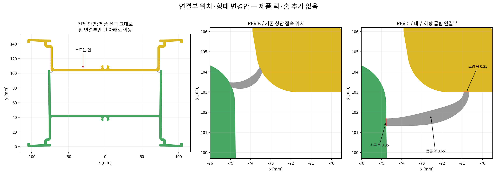
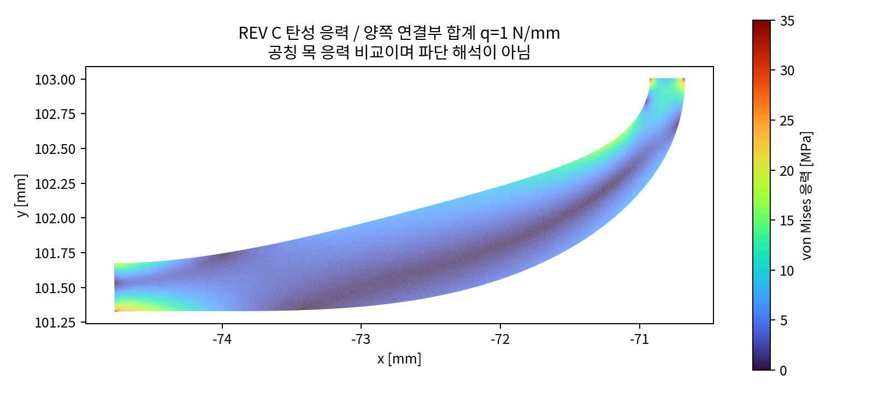
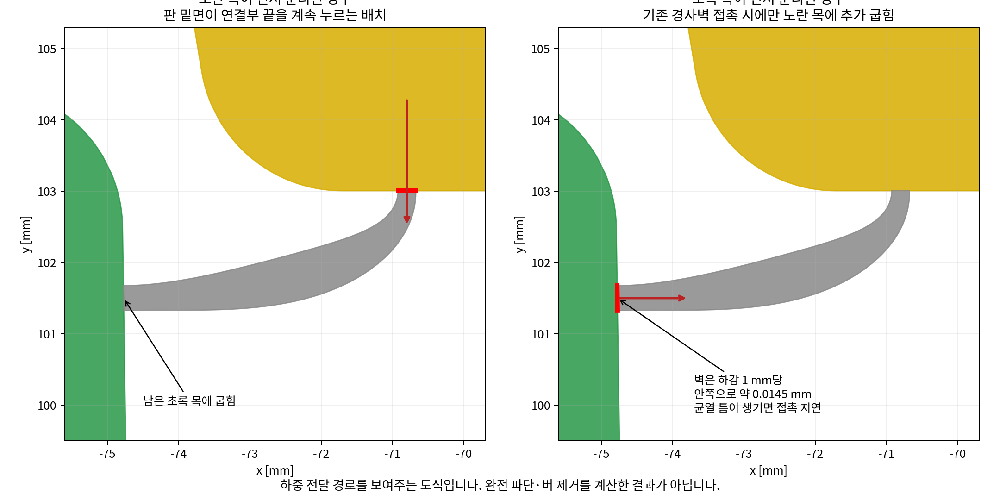
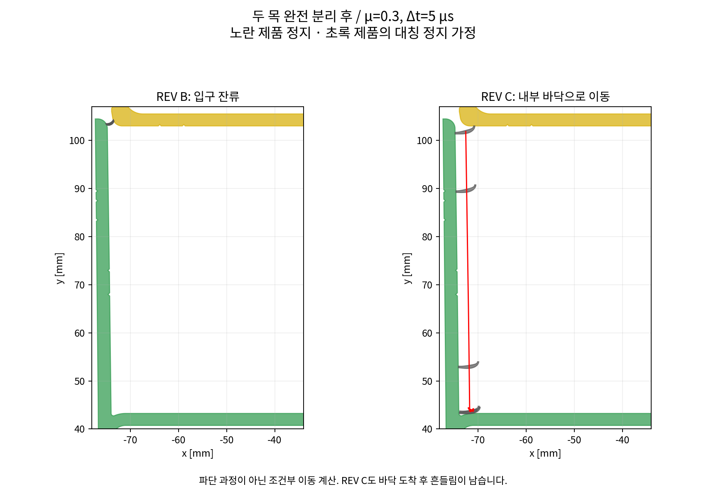

# REV B 재검토 및 연결부 위치 변경 REV C

**사용자 조건:** A6063, 최종 T5. 초록 제품을 바닥에 놓고 별도 고정 없이 노란 제품의 아래쪽 넓은 가로판을 누르거나 고무망치로 타격한다. 제품 판 휨은 제외한다. 제품 윤곽을 바꾸지 않고 흰 연결부만 수정한다. 최종 길이 약 6 m, 압출 중 작업은 약 1 m 나온 시점부터 검토한다.

**이번 결론:** REV B의 안정적인 내부 낙하는 확인되지 않았다. REV C는 연결부를 노란 판 아래의 내부 공간으로 옮겨, 양끝이 완전히 끊어진 뒤 내부로 진입하는 조건을 개선한 후보이다. 그러나 **두 목의 완전 파단, 깨끗한 절단면, 타격 후 최종 정지 및 6 m 전 길이 분리를 검증한 설계는 아니다.**

## 1. 질문에 대한 직접 답변

|질문|REV B|추천 후보 REV C|
|---|---|---|
|어느 목이 먼저 약해지는가?|초록 목의 공칭 응력 지표가 노란 목의 약 2.15배. 초록 쪽이 먼저 소성화될 경향.|노란 목의 지표가 초록 목의 약 1.19배. 노란 쪽이 조금 먼저 약해지도록 조정. 실제 파단 순서는 미확정.|
|두 목이 동시에 떨어지는가?|지지하기 어려움.|공칭 지표는 가까워졌지만 동시 파단 보장 불가. 노란 쪽 우선 분리 후 연속 가압을 목표로 함.|
|한쪽이 먼저 끊어져도 나머지에 힘이 전달되는가?|초록 쪽이 끊어지면 노란 쪽에 매달릴 수 있음. 자중만으로 나머지를 끊는다는 근거 없음.|노란 목 선분리 시 판 밑면이 연결부 끝을 계속 누르는 경로가 있음. 초록 목 선분리 시에는 기존 경사벽 접촉이 있어야 추가 하중이 생김.|
|내부로 떨어지는가?|정밀 접촉 계산에서 입구 잔류. 안정적인 내부 진입으로 판정하지 않음.|정지 상태에서 두 목을 이미 끊어 놓은 9개 조건은 모두 내부 바닥 도달. 일부 흔들림·미끄러짐 잔존.|
|6 m를 손이나 망치로 깨끗하게 분리할 수 있는가?|확인되지 않음.|확인되지 않음. 판 휨 없는 6 m 동시 변위 모델은 손 압력만으로 전 길이 동시 분리를 지지하지 않음.|

## 2. 해석 범위와 공통 조건

세 가지 계산을 구분했다. (1) 두 제품을 강체로 둔 연결부의 2D 선형 탄성 유한요소 계산, (2) 한 목이 이미 끊어졌을 때 남은 목에 하중이 전달되는지 보는 선형 접촉 하중 근사, (3) 두 목이 모두 끊어진 뒤의 2D 강체 접촉·낙하 계산이다. 연결부 탄성 계산은 평면응력, 포아송비 0.33으로 근사했으며 길이 방향 구속과 응력 삼축성 변화는 포함하지 않았다. 이들을 연결해 실제 균열 생성부터 최종 낙하까지 연속으로 계산한 손상 해석은 아니다.

노란·초록 제품의 판 휨은 제외했다. 중심 가압, 좌우 연결부가 대칭인 상태에서는 전체 수평력과 회전이 상쇄된다고 가정하고 초록 제품을 정지 기준으로 두었다. 이것은 실제 바닥 고정 장치를 추가한 것이 아니라 대칭 상태의 단순화다. **한쪽만 때리거나 한쪽 연결부가 먼저 끊어지는 경우의 미끄러짐·기울어짐은 계산하지 않았으므로, 별도 고정 없는 실제 작업에 대한 보장은 아니다.**

기하 계산 원점은 원본 DXF의 X=282.5006121, Y=107.1826197 mm이다. 보고서 그래프의 y=0은 제품 바닥이다. 단면 폭 약 210.99 mm, 전체 높이 약 146.24 mm. 6 m 노란 제품 질량 약 13.16 kg, 두 제품 합계 약 31.46 kg. 연결부 한 줄의 6 m 질량은 REV B 약 9.22 g, REV C 약 36.11 g이다.

낙하 모델은 마찰계수 μ=0.1 / 0.3 / 0.6, 반발계수 e=0.1, 중력 9.81 m/s²를 가정했다. 마찰은 실제 산화막·온도·윤활 상태 측정값이 아니다. 제품과 조각을 강체로 두었으며 충돌 소성, 마찰 발열, 롤링 저항, 6 m 길이 방향 휨·비틀림은 없다. 주 결과는 노란 제품이 멈춘 상태에서 **연결부의 두 목이 처음부터 모두 완전히 분리되어 있다**는 조건이다. 길이 전체를 한 강체 조각으로 취급했다.

## 3. REV B: 내부 낙하가 안정적이라고 할 수 없는 이유

REV B는 기존 접속 위치에서 흰 연결부 상부선만 원호로 바꾼 형상이다. 초록·노란 목은 모두 0.25 mm이다. 같은 외력에서 초록 목 공칭 응력 계수 약 24.28, 노란 목 약 11.32 MPa/(N/mm)로 차이가 크다. 초록 목이 먼저 약해지고, 조각이 노란 목에 붙어 있을 가능성을 배제할 수 없다. **이는 실제 균열 순서 예측이 아니라 목 단면 지표의 비교다.**

두 목을 모두 끊었다고 가정해도 상단 입구의 형상과 접촉 때문에 멈췄다. Δt=5 μs, 접촉 반복 120회, 표면 근사 및 허용 간격 0.0001 mm 조건에서 μ=0.1은 약 0.098 mm만 내려갔고, μ=0.3과 0.6은 사실상 제자리에 남았다. μ=0.1과 0.3을 1.5 s까지 계산해도 내부 바닥으로 내려가지 않았다.

초기 거친 계산에서 μ=0.1은 바닥까지 떨어졌지만, 시간 간격만 20 → 10 → 5 μs로 줄인 재검증에서는 마지막 결과가 입구 잔류로 바뀌었다. 따라서 초기 낙하 결과와 매개변수 조합의 성공 개수를 실제 성공률로 쓰지 않았다. 양끝이 이미 끊어진 뒤 노란 제품에 총 200 N을 가한 정밀 대칭 모델에서도 입구 잔류가 유지됐다. 고무망치 에너지를 가정한 예비 계산은 제품 관통 오류가 있어 유효 결과에서 제외했다.

반면 처음부터 연결부를 안쪽으로 1.5 mm, 아래로 3 mm 옮기고 노란 제품을 1 mm 내린 조건에서는 내부 바닥 영역까지 약 0.106 s에 도달했다. **이 초기 이동은 계산자가 부여한 조건으로 실제로 자동 발생한다는 뜻이 아니다.** 병목은 큰 내부 공간보다 상단 입구 이탈에 있음을 보여준다.

REV B의 6 m 조각 자중이 남은 노란 목에 줄 수 있는 최대 모멘트는 약 0.079 N·mm이다. 0.25 mm 목이 6 m 전 길이에 온전히 남아 있을 때의 이상화 소성 모멘트는 대표 강도 기준 고온 약 1,125, 공랭 후 약 5,156, T5 약 13,594 N·mm이다. 자중으로 온전한 두 번째 목이 저절로 끊어진다고 볼 수 없다. 이미 대부분 균열이 진행된 목에 대해서는 이 비교를 적용할 수 없다.

## 4. REV C 형상과 두 가지 조정안

흰 연결부를 **기존 초록 내벽과 노란 판 밑면 사이**로 옮겼다. 제품 표면에 턱·홈·가이드·돌기를 추가하지 않는다. 기존 네 제품 엔티티의 모든 좌표, 원호 bulge, 폭과 열린/닫힌 상태가 원본과 같음을 DXF 저장 후 재확인했다. 기존 접속 목의 끝면을 닫는 선은 원래 제품 형상을 명시한 것으로, 제품 부피를 추가하지 않는다.

|항목|우선 추천 REV C|
|---|---|
|초록 목 중심, 왼쪽|(-74.774808, 101.500000) mm, 기존 내벽 위|
|노란 목 중심, 왼쪽|(-70.800000, 103.005739) mm, 기존 판 밑면 위|
|초록 목 / 노란 목|0.35 / 0.25 mm|
|연결부 몸통 폭|약 0.65 mm, 끝으로 매끄럽게 얇아지는 곡선|
|두 접속 중심 직선 거리|약 4.250 mm|
|오른쪽|단면 중심선을 기준으로 거울 대칭|

흰 몸통의 중심선은 두 접속면에 수직으로 들어가는 cubic Bézier 곡선이며, 폭을 점진적으로 변화시켰다. 계산 코드에 곡선 정의를 포함했다. 단순히 제품을 파서 만든 날카로운 V홈은 사용하지 않았다. 도면은 검토용 조립 경계이며, 접속부의 제품선은 내부 재료 경계 표시이지 절개 틈이 아니다.

**동시 약화에 더 가까운 비교안:** 같은 위치에서 초록 목 0.28 / 노란 목 0.25 mm로 두면 공칭 응력 비가 노랑/초록 약 1.01이었다. 하지만 실제 파단 순서를 제어하기 어렵고, 먼저 떨어진 쪽에 따라 후속 동작이 달라진다. 이 비교안은 탄성 지표만 계산했으며 별도의 낙하 검증 도면으로 채택하지 않았다.

**우선 추천안:** 초록 목 0.35 / 노란 목 0.25 mm. 정밀 요소 크기 0.005 mm에서 노랑/초록 지표 비 약 1.194. 노란 쪽 우선 약화 후 남은 초록 목을 누르는 경로를 우선한다. 같은 모델에서 공차를 가정한 극단 조합 0.33/0.27 및 0.37/0.23 mm는 비가 약 1.04 / 1.38이었다. ±0.02 mm는 계산 민감도를 보기 위한 가정이며 압출 공차 달성 보장이 아니다. 실제 두께·강도 편차와 균열 때문에 순서가 바뀔 수 있다.

초록·노란 목 공칭 응력 계수는 각각 25.71, 30.70 MPa/(N/mm). 목 중심에서 0.5 mm 이상 떨어진 몸통의 요소 최대 응력 계수는 약 17.59였다. 이번 선형 모델에서는 몸통 중앙보다 목 지표가 높았지만, 접속 코너의 특이 응력·대변형 손상·버 발생은 평가하지 않았다. 요소 크기 0.02 → 0.01 → 0.005 mm에서 목 지표 비는 1.196 → 1.195 → 1.194로 수렴했다.

## 5. 한 목이 먼저 끊어진 뒤 나머지는 어떻게 되는가

**노란 목이 먼저 끊어지는 경우:** 노란 판 밑면 바로 아래에 연결부 끝이 있으므로, 판이 내려오면서 그 끝을 계속 눌러 남은 초록 목을 굽히는 배치다. 접촉점에서 초록 목까지 수평 지레 길이는 약 3.975 mm이다. 남은 연결부에 선형 탄성과 이상화된 끝단 수직 접촉 하중을 적용하면, 초록 목 공칭 항복 지표에 도달하는 추가 하강량은 대표 강도에서 고온 약 0.0054 mm, 공랭 후 약 0.014 mm, T5 약 0.038 mm이다. 100 mm 유효 길이에 해당하는 양측 합계 수직 반력은 각각 약 12 / 56 / 149 N이다. **이는 이미 한 목을 제거한 뒤 남은 목이 약해지기 시작하는 지표이며, 완전 파단 하중·파단 스트로크가 아니다.**

**초록 목이 먼저 끊어지는 경우:** 연결부가 노란 판과 함께 내려가면 기존 초록 내벽의 안쪽 기울기 때문에 초록 쪽 끝이 벽에 닿을 수 있다. 내벽은 하강 1 mm당 안쪽으로 약 0.01454 mm 이동한다. 벽에 틈 없이 계속 접촉하고 미끄럼 마찰을 무시한 선형 근사에서 남은 노란 목의 공칭 항복 지표에 도달하는 하강량은 고온 약 0.080 mm, 공랭 후 약 0.212 mm, T5 약 0.560 mm이다. 그러나 파단 후 수평 틈이 0.02 / 0.05 / 0.10 mm만 생겨도 재접촉까지 약 1.4 / 3.4 / 6.9 mm 하강이 더 필요하다. 접촉이 사라지면 추가 하중도 사라진다. 따라서 이 순서까지 깔끔한 후속 파단을 보장하지 않는다.

남은 목 하중 계산은 앞 단계의 소성·균열 이력을 물려받지 않았고 접촉 분포도 끝면 하중으로 단순화했다. 두 경우 모두 소성 힌지처럼 접히기만 하고 남을 가능성, 고온에서 늘어나 붙어 있을 가능성, 절단면에 버가 남을 가능성은 해소되지 않았다. 그래서 두 목의 완전 동시 파단을 목표로 목을 무조건 같게 만드는 것보다, 노란 쪽 우선 약화와 계속 누를 수 있는 배치를 권한다.

## 6. REV C의 내부 낙하: 도착과 안정 정지를 구분

아래는 초기 속도·회전 0, 두 목 완전 분리, 노란 제품 정지 조건이다. 바닥 영역 도착은 조각 무게중심 y<46 mm, 하강량>50 mm, 내부 x 범위로 정의했다. 정지 기준은 마지막 0.1 s 동안 속도<5 mm/s 및 각속도<1 rad/s이다. 실제 내측 바닥 표면은 y 약 43.24 mm이다. 최종 무게중심 y는 조각 자세에 따라 이보다 높다.

|μ|시간 간격 μs|계산 시간 s|바닥 영역 도착 s|최종 중심 x mm|최종 중심 y mm|결과|
|---|---:|---:|---:|---:|---:|---|
|0.1|20|0.6|0.107|-41.68|43.79|내부 바닥·정지 기준 충족|
|0.1|5|0.6|0.107|-71.76|43.62|내부 바닥·정지 기준 충족|
|0.1|2.5|0.3|0.107|-66.25|43.79|내부 바닥·정지 기준 미충족|
|0.3|20|0.6|0.107|-71.74|43.63|내부 바닥·정지 기준 충족|
|0.3|5|0.6|0.107|-71.57|43.66|내부 바닥·정지 기준 미충족|
|0.3|2.5|0.3|0.107|-71.60|43.65|내부 바닥·정지 기준 미충족|
|0.6|20|0.6|0.108|-71.62|43.73|내부 바닥·정지 기준 미충족|
|0.6|5|0.6|0.108|-71.80|43.79|내부 바닥·정지 기준 충족|
|0.6|2.5|0.3|0.108|-71.81|43.81|내부 바닥·정지 기준 충족|

9개 조건 모두 약 0.107–0.108 s에 내부 바닥 영역에 도착했다. 시간 간격을 더 작게 해도 입구 잔류로 바뀌지는 않았다. 하지만 일부는 바닥에서 흔들리거나 미끄러졌고, 저마찰 조건의 최종 x 위치는 시간 간격에 민감했다. **“내부 바닥 영역으로 들어가는 경향 개선”은 확인했지만, 정확한 최종 위치·자세와 모든 경우의 안정 정지는 확인하지 못했다.** 조각이 놓인 채 제품을 더 포개면 조각이 간섭할 수도 있으며, 이 후속 조립 과정은 검증하지 않았다.

### 분리 직후 속도 민감도

파단 반동이나 타격을 직접 계산하는 대신, 이미 분리된 조각에 ±100 mm/s의 수평·수직 속도와 ±20 rad/s 회전을 부여한 12개 추가 조건을 시도했다. 반발계수는 0.1, 계산 시간은 0.18 s이다. 이는 고무망치 충격 해석도 실제 확률분포도 아니다. 각 경우 최대 계산 시간을 제한했고, 미완료·관통 오류는 성공/실패 통계에 넣지 않는다.

|μ|vx / vy / ω (mm/s, mm/s, rad/s)|계산 종료 결과|기록 시점 관통 검사|
|---|---|---|---|
|0.1|-100 / -100 / 20|내부 바닥·정지 기준 미충족|통과|
|0.1|-100 / 100 / -20|내부 바닥·정지 기준 미충족|통과|
|0.1|100 / -100 / 20|내부 바닥·정지 기준 미충족|통과|
|0.1|100 / 100 / -20|내부 바닥·정지 기준 미충족|통과|
|0.3|-100 / -100 / 20|내부 바닥·정지 기준 미충족|통과|
|0.3|-100 / 100 / -20|내부 바닥·정지 기준 미충족|통과|
|0.3|100 / -100 / 20|내부 바닥·정지 기준 미충족|통과|
|0.3|100 / 100 / -20|내부 바닥·정지 기준 미충족|통과|
|0.6|-100 / -100 / 20|내부 바닥·정지 기준 미충족|통과|
|0.6|-100 / 100 / -20|내부 바닥·정지 기준 미충족|통과|
|0.6|100 / -100 / 20|내부 바닥·정지 기준 미충족|통과|
|0.6|100 / 100 / -20|내부 바닥·정지 기준 미충족|통과|

유효 종료 및 관통 기준을 통과한 조건 12개 중 내부 바닥 영역에 도달한 것은 12개다. 이는 선택한 초기조건의 계산 결과 개수이며 **작업 성공률이 아니다.** 이번 12개 추가 조건은 모두 완료되고 관통 기준을 통과했다. 0.18 s의 짧은 종료 시간에서는 정지 판정 구간에 바닥 도달 전 운동도 들어가므로, 정지 기준 미충족만으로 계속 움직인다고 단정하지 않는다. 다만 안정 정지까지 확인한 결과도 아니다. 정지 출발 결과를 실제 타격의 모든 반동 상태로 일반화하지 않는다.

## 7. 압출 중 / 공랭 후 / T5 후 비교

온도별 실측 응력–변형률·파단 변형률이 없으므로 아래 강도를 민감도 가정으로 사용했다. 특히 압출 중 상태와 시효 전 상태를 T5 물성으로 계산하지 않았다. A6063라는 표기만으로 표의 수치가 보장되는 것은 아니다.

공칭 지표는 단위 길이 양측 합계 하중 q에 대해 REV B 초록 목 24.28q, REV C 노란 목 30.70q MPa이다. 해당 값이 가정한 항복강도에 도달하는 하중을 표로 환산했다. **최초 실제 미세 항복이나 완전 파단 하중이 아니다.**

|상태|대표 온도 °C|가정 강도 하한/대표/상한 MPa|REV B 100 mm 환산 N|REV C 100 mm 환산 N|REV C 6 m 동시 환산 kN|
|---|---:|---|---|---|---|
|압출 중|480|5 / 12 / 25|21–103 (대표 49)|16–81 (대표 39)|1.0–4.9 (대표 2.3)|
|공랭 후·시효 전|25|35 / 55 / 90|144–371 (대표 227)|114–293 (대표 179)|6.8–17.6 (대표 10.8)|
|T5 시효 후·상온|25|110 / 145 / 170|453–700 (대표 597)|358–554 (대표 472)|21.5–33.2 (대표 28.3)|

**100 mm는 단면 비교를 위한 유효 길이 환산이다. 손이나 망치의 접촉 폭이 100 mm라고 해서 연결부의 작용 길이가 100 mm라는 뜻이 아니다.** 제품이 6 m 전 길이에 걸쳐 강체로 함께 내려가고 연결부 상태도 균일하다면 전체 하중은 6 m 열을 적용해야 한다. 사용자가 제외한 제품 판 휨이나, 길이 방향 순차 균열을 몰래 허용해 작은 힘으로 6 m를 끊는 것으로 해석하지 않았다.

**압출 중:** 출구 510°C, 속도 10 m/min이면 1 m 나오는 데 6 s이다. 공랭 h=30 W/(m²·K)의 단순 집중 열용량 근사에서 약 486–492°C, h=10–80 범위에서는 약 448–504°C였다. 대표 480°C, E=40 GPa를 사용했다. REV C의 대표 공칭 지표 하중은 노출된 1 m 전체 균일 작용 시 약 391 N이다. 실제 압출 다이의 구속, 풀러, 종방향 온도 구배와 이동하는 파단점은 계산하지 않았다. 고온에서는 목이 쉽게 굽혀져도 늘어나면서 붙어 있을 수 있어, 깔끔한 파단과 강체 낙하를 확인했다고 볼 수 없다.

**공랭 후·시효 전:** 상온 25°C, E=69 GPa, 대표 강도 55 MPa로 두었다. 손 압력 200 N을 대표 조작 수준, 100–400 N을 단순 참고 범위로 본다. 국부 작용 길이가 짧다면 목 지표에 도달할 수 있으나, 6 m 전체를 강체로 함께 누르는 대표 환산은 약 10.8 kN이다. 따라서 이 모델은 손으로 전 길이 동시 분리를 지지하지 않는다. 실제 공랭 속도, 보관 중 자연 시효에 따른 강도 변화는 측정이 필요하다.

**T5 시효 후·충분히 식힘:** 상온 25°C, E=69 GPa, 대표 강도 145 MPa. 100 mm 환산도 약 472 N, 6 m 동시 환산은 약 28.3 kN이다. 손 압력 200 N으로 6 m가 한 번에 끊어진다고 할 수 없다. 고무망치는 예시로 0.5 kg, 2 m/s이면 운동에너지 1 J이지만, 전달 에너지·충돌 시간·고무 경도·접촉 위치에 따라 달라진다. 이를 임의의 순간 힘으로 바꿔 파단 성공을 주장하지 않았다. 실제 노치 파괴에너지와 3D 충격 해석 또는 시편 시험이 필요하다.

낙하 표는 이미 분리된 강체 조각에 대한 기하·마찰 계산이다. 냉각 후와 T5 후의 분리 형상이 같다면 이를 조건부 참고할 수 있다. 고온에서는 조각 자체의 소성 변형이 커질 수 있어 동일한 강체 결과의 신뢰도가 더 낮다. 세 단계 각각의 실제 균열·충돌 과정을 완료한 시뮬레이션으로 읽으면 안 된다.

## 8. 포개짐과 금형 제작 관점

연결부를 완전히 제거했을 때 노란·초록 제품 형상은 원본과 같으므로 원본 대비 추가 제품 간섭은 없다. 하강 0 / 1 / 5 / 10 / 20 / 25 / 30 mm 표본에서 제품끼리의 겹침은 없었고 40 mm에서는 기존 제품 형상끼리 겹침이 생겼다. 내부 판 사이 초기 약 59.77 mm를 최종 조립 스트로크로 사용하면 안 된다. 잔여 목·버나 바닥에 떨어진 조각이 남아 있으면 포개짐에 영향을 줄 수 있다.

REV C의 금형상 장점은 제품에 언더컷·돌기를 추가하지 않고, 기존 최솟값 0.25 mm를 더 얇게 만들지 않으며, 몸통을 약 0.65 mm로 유지하고 급격한 가시형 형상을 피했다는 점이다. 원본과 같은 하나의 연결된 금속 단면과 하나의 닫힌 내부 공간임을 기하적으로 확인했다. 그러나 **폭 약 211 mm의 단면에서 0.25 mm 목이 무리 없이 압출된다고 보증할 수 없다.** 얇은 목의 충전, 베어링 길이와 유속 균형, 포트홀·용착선 위치, 다이 지지와 실제 내측 반경은 금형사 검토가 필요하다. 이번 계산은 압출 유동·다이 응력 해석이 아니다.

도면의 매끄러운 곡선은 짧은 선분으로 근사했다. 금형 가공 곡선으로 피팅하거나 최소 반경을 바꾼다면 연결부 응력과 낙하를 다시 확인해야 한다. 제품 윤곽에 노치를 파서 반경을 확보하는 수정은 허용 범위에 포함하지 않는다. 이 단계에서 임의의 만능 필렛 반경이나 제작 허용 공차를 확정하지 않는다.

## 9. 검증 기록과 추천 범위

제품 원본 엔티티 4개 동일성, DXF 감사, 연결부/제품 비중첩, 거울 대칭 접속과 단면 연결성을 확인했다. 선형 FEM의 요소 크기 수렴 및 반력 평형을 확인했고, 남은 목 근사도 0.02 / 0.01 mm 요소에서 비교했다. 접촉 모델의 자유낙하 0.1 s 검산 오차는 약 0.00981 mm였다. REV B 정밀 기본 3개와 REV C 기본 9개는 저장한 1 ms 간격의 모든 자세에서 관통 면적 허용 기준을 통과했다. 이는 저장 사이의 모든 순간이 무관통임을 증명하지는 않는다. REV C 기본 결과에서 기록된 최대 조각 겹침 면적은 약 0.001366 mm²였다.

REV B의 관통 오류 예비 결과, 저마찰 시간 간격 의존 결과, 강제 힌지 예비 결과는 안정 낙하의 근거로 쓰지 않았다. REV C의 장시간 연속 가압 및 일부 반동 예비 실행은 계산 비용 때문에 종료했으며 최종 근거에 포함하지 않았다. 최종 표의 기본 조건과 별도 초기속도 조건은 식별자와 완료 여부를 JSON에 남겼다.

**추천은 REV C의 시편 비교 검토까지다.** 제품을 그대로 두면서, 목의 약화 시점을 가까이 하고, 노란 쪽 선분리 후 남은 초록 목을 계속 누를 수 있고, 두 목 분리 후 입구 걸림을 줄이는 후보이다. 양쪽 끝이 어떤 순서로 끊겨도 깔끔하게 분리되고 6 m 조각이 항상 안정적으로 내부에 놓인다는 수준은 아직 충족하지 못했다. 가장 먼저 확인할 실험 항목은 실제 목 두께, 노란/초록 목의 파단 순서, 두 번째 목의 잔류 여부, 버 높이, 반동 후 입구 재걸림이다. 이후 사용자가 지정한 무고정·손 압력/고무망치·6 m 조건에서 길이 방향 분리와 최종 포개짐을 확인해야 한다.

## 10. 파일 사용 안내

`bridge_relocated_revC_CONCEPT.dxf`는 연결부 위치·형태를 바꾼 검토용 도면이다. `bridge_relocated_revC_CONCEPT.pdf`는 치수와 주의사항을 읽기 위한 도면이다. `conditional_drop_revB_revC.gif`는 양끝이 이미 끊어진 뒤의 움직임만 보여준다. `review_results_and_sources.zip`에는 입력 DXF, 계산 코드, 결과 JSON, 재현 방법이 들어 있다. 원본·REV B와 구분해서 보관한다. 이전 REV A는 제품 형상과 포개짐 조건을 위반하여 철회한 상태이며 사용 대상이 아니다.
