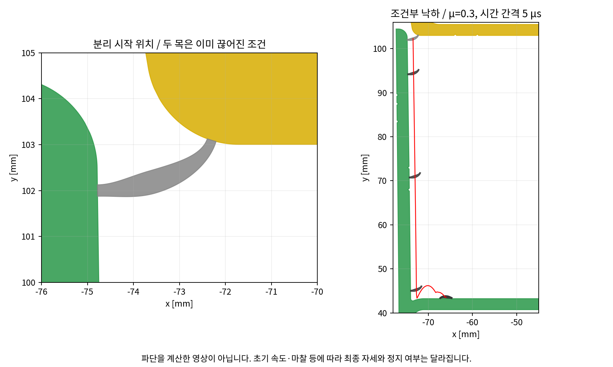
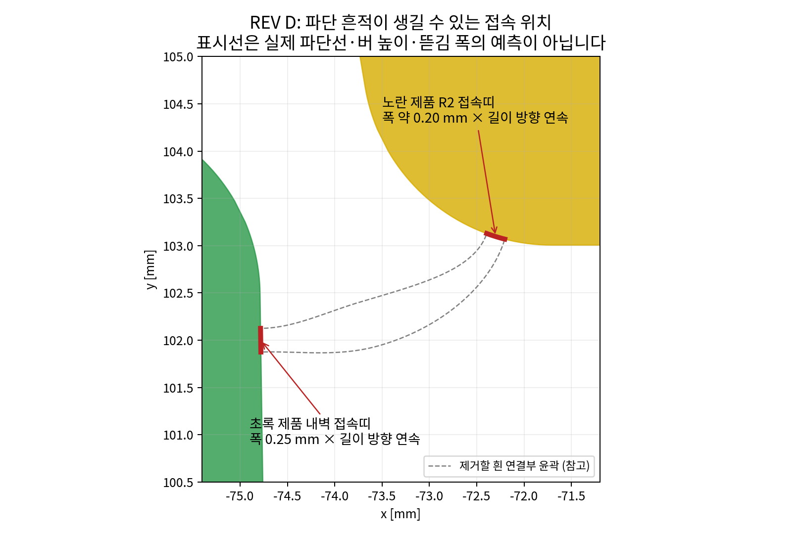

# REV D — 짧은 연결부와 0.20–0.25 mm 목의 자중 검토

작성 기준: 2026-10-23 (한국 시간). 입력: 사용자의 원본 DXF. 노란·초록 제품 윤곽 변경 금지, 흰 연결부만 변경. A6063 최종 T5, 초록 제품 바닥 지지·별도 고정 없음, 노란 아래쪽 넓은 가로판 가압·고무망치 타격, 제품 판 휨 제외. **추가 조건: 파단 후 디버링·연마·트리밍·절삭 등 후처리 없음.**

**파단 자국에 대한 답변:** 후처리 없이 완전히 무자국인 표면은 이번 검토로 보장할 수 없다. REV D는 접속부를 제품 내측 R2와 내벽에 두어 외관 노출을 줄이는 후보이며, 미세 돌기·뜯김·표면 질감 차이가 전혀 없다는 요구를 충족했다고 판정하지 않는다. 제품에 숨김 홈을 파거나 후처리로 보정하는 공정은 포함하지 않았다.

**답변:** 양쪽 연결목이 길이 전체에 온전히 남아 있는 경우, **목 0.20–0.25 mm라는 이유만으로 자중에 의해 저절로 떨어질 것으로 계산되지는 않았다.** 노란 제품 전체 자중을 포함한 공칭 목 응력은 약 0.57–0.75 MPa였다. 다만 고온 압출 중 유동·인장·충격이나, 이미 대부분 끊어져 짧은 구간만 남은 상황에 대한 보장은 아니다.

**추천 REV D:** 초록 목 0.25 mm / 노란 목 약 0.20 mm, 몸통 약 0.50 mm. 노란 접속점을 기존 R2 라운드 위로 옮겨 연결부가 평판 안쪽까지 들어가지 않도록 했다. 접속 중심 거리는 REV C 4.250 → REV D 2.715 mm로 약 36.1% 줄였다. **금형 제조 가능성이나 실제 완전 파단을 확정한 도면은 아니다.**

## 1. 무엇을 바꿨는가

|항목|REV C|REV D|
|---|---|---|
|노란 제품 접속 위치|평판 밑면 x=-70.800 mm|기존 R2 라운드 위, 접속 현 중심 x=-72.299 mm|
|초록 제품 접속 위치|기존 내벽 y=101.500 mm|기존 내벽 y=102.000 mm|
|접속 중심 직선 거리|4.250 mm|2.715 mm|
|연결부 중심선 길이|직선 거리와 구분 필요|2.850 mm|
|초록 / 노란 목|0.35 / 0.25 mm|0.25 / 약 0.20 mm|
|몸통 폭|약 0.65 mm|약 0.50 mm|
|한 줄의 연결부 6 m 질량|약 36.11 g|약 17.10 g|
|제품 윤곽|원본 보존|원본 보존|

좌표는 원본에서 X=282.5006121, Y=107.1826197 mm를 뺀 기준이다. REV D 왼쪽 초록 목 중심은 (-74.782078, 102.000000), 노란 목 접속 현 중심은 (-72.299201, 103.098635) mm이다. 오른쪽은 거울 대칭이다. 노란 목은 기존 R2의 바닥 접선에서 약 17.28° 올라간 위치에 붙는다. 접속 원호 길이 0.200 mm, 현 길이 약 0.199902 mm이므로 실용 표기는 약 0.20 mm로 했다.

노란 제품 평판이 시작되는 x=-71.705746 mm보다 연결부 전체가 바깥쪽에 놓인다. 제품의 라운드를 깎거나 평평하게 만들지 않았다. 초록 목 윗끝도 기존 초록 라운드 시작점에서 약 0.375 mm 아래에 두었다. 새 돌기·턱·홈·가이드는 없다.

## 2. 더 짧게 만들 수 있는데 왜 2.715 mm인가

길이·높이·곡선 접선 길이·몸통 두께 분포를 바꿔 비교했다. 접속 중심 거리 약 2.138 mm인 더 짧은 형상도 기하적으로 만들 수 있었다. 그러나 해당 비교안의 노랑/초록 공칭 목 응력 비는 약 0.44로, 초록 목 쪽 지표가 약 2.28배 높아졌다. 한쪽이 먼저 약해지는 불균형이 다시 커지는 방향이다.

채택한 REV D는 정밀 탄성 계산에서 노랑/초록 지표 비가 약 1.010였다. 두 끝의 약화 시점을 가깝게 두면서 평판 안쪽의 긴 연결부를 없애는 절충안이다. **2.715 mm는 금형사가 확정한 최소 제작 길이나 전역 최적값이 아니다.** 더 짧은 길이만을 목표로 고르면 파단 순서, 접촉 경로, 실제 금형 지지가 달라진다.

몸통은 곡선으로 만들고 두께를 점진적으로 변화시켰으며, 날카로운 가시형 제품 노치는 추가하지 않았다. 다만 0.20 mm 금속 목은 여전히 얇다. 짧아졌다는 이유만으로 충전 불량·용착선·다이 강도 문제가 해소됐다고 판단하지 않는다. 목을 두껍게 하거나 곡선 반경을 바꾸는 금형 보정이 필요하면, 제품 윤곽은 그대로 두고 흰 연결부만 보정한 뒤 다시 비교해야 한다.

## 3. 자중을 어떻게 계산했는가

작은 흰 조각만의 무게가 아니라, **연결부가 받치는 노란 제품 전체 무게**를 사용했다. 원본 노란 단면적은 약 812.17 mm²이고 밀도 2,700 kg/m³를 가정하면 6 m 질량은 약 13.157 kg, 무게는 약 129.07 N이다. 초록 제품은 바닥에 있으므로 초록 제품 자체 무게를 연결부가 매다는 것으로 계산하지 않았다.

두 연결부의 작은 자중까지 모두 노란 쪽 하중으로 더하는 근사를 적용했다. REV D에서는 양측 연결부 합계 질량이 노란 제품의 약 0.26%이므로 이 보정의 영향은 작다. 양쪽 연결부가 전체 길이에 연속해 있고 하중이 균일하게 분산되면, 양측 합계 단위 길이 하중 q는 약 0.02157 N/mm이다.

`q = (노란 제품 단위 길이 질량 + 연결부 2줄 단위 길이 질량) × g`

6 m에서 무게는 1 m의 6배지만 연결 길이도 6배다. 따라서 **전 길이 연속 연결이라는 조건에서는 단위 길이 응력이 길이만으로 6배가 되지 않는다.** 연결부 탄성 FEM의 공칭 목 응력 계수에 q를 곱해 자중 응력을 구했다. 단순 전단 면적만으로 버틴다고 판단하지 않고, 목의 축력·전단력·굽힘 모멘트를 함께 반영했다. 응력 집중부의 실제 최초 미세 항복·균열이나 고온 크리프는 별도로 계산하지 않았다.

## 4. 목 두께 0.20 / 0.225 / 0.25 mm 비교

|초록 / 노란 목 mm|자중 공칭 응력 MPa|고온 가정 하한 5 MPa 대비 배율|공랭 후 가정 하한 35 MPa 대비 배율|T5 가정 하한 110 MPa 대비 배율|노랑/초록 목 응력 비|
|---|---:|---:|---:|---:|---:|
|0.200 / 0.200|0.745|6.7|47|148|0.869|
|0.225 / 0.225|0.648|7.7|54|170|0.819|
|0.250 / 0.250|0.571|8.8|61|193|0.775|
|0.250 / 0.200|0.595|8.4|59|185|1.010|

표의 배율은 가정한 항복강도를 공칭 자중 응력으로 나눈 값으로, 검증된 설계 안전율이나 취급 허용하중이 아니다. 제품 판 휨과 손상은 제외했다. 두께가 모두 0.20 mm인 비교안에서도 공칭 자중 응력은 약 0.745 MPa였다. 공랭 후·시효 후 상온에서는 자중만으로 온전한 연결목이 저절로 파단되는 결과를 지지하지 않는다. 압출 중 대표 480°C에서도 가정한 순간 항복 지표보다 낮았으나, 고온 지속 하중·압출 인장·유동 편차를 포함한 보장은 아니다.

추천안의 초록 목을 0.25, 노란 목을 0.20 mm로 다르게 둔 것은 자중 때문이 아니라 **두 접속 방향이 달라 같은 두께가 같은 응력을 만들지 않기 때문**이다. 두 목을 모두 0.25 mm로 두면 노랑/초록 지표 비가 약 0.775로, 초록 쪽에 더 큰 지표가 생겼다. 추천안에서는 비가 약 1.010으로 가까워진다.

두께 편차를 가정해 0.24/0.21 및 0.26/0.19 mm도 계산했다. 노랑/초록 지표 비는 약 0.928 / 1.100으로 순서가 바뀔 수 있었다. ±0.01 mm는 민감도 계산용 가정이며, 금형 제작·압출 공차를 보장하거나 지정한 값이 아니다. **공칭 응력이 비슷하다고 두 목이 정확히 동시에 파단된다는 뜻은 아니다.**

## 5. 자중으로 떨어질 수 있는 조건은 무엇인가

이미 대부분의 연결목이 끊어지고 짧은 길이만 남으면 상황이 달라진다. 6 m 노란 제품의 전체 무게를 남은 양쪽 연결 길이 L_eff가 균일하게 받는 단순화에서는 `q = 전체 무게 / L_eff`가 된다. 원래 6,000 mm에 분산되던 하중이 100 mm에만 걸리면 단위 길이 하중은 60배다.

추천 REV D에서 공칭 항복 지표에 도달하는 남은 양측 공통 연결 길이를 역산하면 다음과 같다. 표는 **6 m 제품 전체 무게가 남은 구간에 걸린 경우**이며 실제 균열 전파 길이를 예측한 것이 아니다.

|재료 상태|가정 항복강도 하한/대표/상한 MPa|100 mm 공칭 지표 하중 N|6 m 동시 지표 하중 대표 kN|6 m 자중을 버티는 잔여 연결 길이의 공칭 지표 경계 mm — 하한 강도 기준|
|---|---|---|---:|---|
|압출 중 대표 480°C|5 / 12 / 25|18–91 (대표 44)|2.6|713 (대표 강도 297)|
|공랭 후·시효 전 25°C|35 / 55 / 90|127–327 (대표 200)|12.0|102 (대표 강도 65)|
|T5 후·상온 25°C|110 / 145 / 170|399–617 (대표 526)|31.6|32 (대표 강도 25)|

예를 들어 공랭 후 가정 하한 강도에서는 남은 구간이 약 102 mm, T5 하한 강도에서는 약 32 mm 수준이면 자중만으로도 공칭 항복 지표에 도달할 수 있다. 그보다 짧아지면 늘어나거나 굽혀지며 뒤따라 분리될 가능성을 배제할 수 없다. 실제 파단은 균열·버·길이 방향 응력 집중·변형 이력에 좌우된다. 한쪽 연결부만 남은 경우에는 하중 분담과 회전도 달라지므로 위 표를 그대로 적용할 수 없다.

압출 중 1 m가 나온 시점에 노출된 1 m의 무게만 받는 경우, 위 고온 6 m 무게 기준의 잔여 길이 수치는 대략 1/6로 환산된다. 온전하게 1 m 전 길이가 연결되어 있다면 단위 길이 자중 응력은 6 m 연속 연결 조건과 같다. 실제 다이 구속·풀러·자유로 나온 길이의 휨은 이 근사에 포함되지 않는다.

따라서 **얇은 목의 자중 유지 가능성**과 **부분 파단 후 남은 목이 자중에 의해 추가로 약해지는 현상**은 구분해야 한다.

## 6. 먼저 떨어진 쪽에 따른 후속 동작

REV D의 정밀 공칭 목 응력 계수는 초록 약 27.29, 노란 약 27.55 MPa/(N/mm)이다. 두 끝이 비슷한 지표에 도달하도록 맞췄으나 제조 편차와 손상 때문에 어느 쪽이 먼저 떨어질지는 확정하지 않는다.

노란 목이 먼저 끊어졌다고 가정하면 기존 노란 R2 표면이 흰 연결부 끝을 누를 수 있다. 이상화된 마찰 없는 원호 법선 접촉 하중을 주는 선형 근사에서, 남은 초록 목 공칭 항복 지표까지의 추가 노란 하강량은 대표 강도 기준 고온 약 0.0020 mm, 공랭 후 약 0.0052 mm, T5 약 0.0137 mm였다. **추가 하중 전달 경로를 보는 계산이지 파단 스트로크가 아니다.** 접촉점이 미끄러져 달라지는 큰 회전은 포함하지 않았다.

초록 목이 먼저 끊어지면 기존 초록 내벽과 연결부 끝의 접촉이 남아 있어야 노란 목을 더 굽힐 수 있다. 접촉 틈이 없는 선형 근사에서 남은 노란 목 지표까지의 하강량은 고온 약 0.060 mm, 공랭 후 약 0.161 mm, T5 약 0.423 mm였다. 기존 내벽은 하강 1 mm당 안쪽으로 약 0.01454 mm 들어오므로, 파단 후 수평 틈이 0.05 mm 생기면 재접촉까지 약 3.4 mm 하강이 더 필요하다. 접촉이 없어지면 남은 목을 계속 끊는 작용도 약해진다.

각 계산은 앞선 균열의 소성 이력을 물려받지 않았다. 온전한 상태의 자중 계산과 한 목 제거 후 계산을 실제 연속 파단 과정처럼 합쳐 읽으면 안 된다. 깨끗한 절단면, 버 제거, 두 번째 목의 완전 분리는 여전히 시편 확인 대상이다.

## 7. 완전 분리 뒤 내부로 들어가는가

제품을 변형하지 않는 2D 강체 접촉 모델을 적용했다. **두 목이 이미 완전히 끊어진 상태**에서 노란 제품을 정지시키고, 대칭 가압의 정지 기준으로 초록 제품을 두었다. 편심 타격에서 실제 무고정 제품이 움직이거나 기울어지는 현상은 포함하지 않았다. 두꺼운 제품 판 휨은 사용자 조건대로 제외했다.

마찰계수 μ=0.1 / 0.3 / 0.6, 반발계수 0.1, 중력 9.81 m/s². 기본 정지 출발 9조건은 시간 간격 10 / 5 / 2.5 μs로 각각 0.6 s 계산했다. 분리 직후의 반동 민감도 6조건은 vx,vy=±100 mm/s와 ω=±20 rad/s를 조합해 0.2 s까지 계산했다. 이는 실제 고무망치 충격이나 고온 소성 해석이 아니다.

|μ|시간 간격 μs|바닥 영역 첫 도착 s|최종 무게중심 x / y mm|기본 조건 결과|
|---|---:|---:|---|---|
|0.1|10|0.108|-52.18 / 43.56|바닥 도달·정지 기준 미충족|
|0.1|5|0.108|-52.53 / 43.56|바닥 도달·정지 기준 미충족|
|0.1|2.5|0.108|-72.62 / 43.35|바닥 도달·정지 기준 충족|
|0.3|10|0.108|-66.85 / 43.63|바닥 도달·정지 기준 미충족|
|0.3|5|0.108|-65.97 / 43.59|바닥 도달·정지 기준 충족|
|0.3|2.5|0.108|-67.16 / 43.59|바닥 도달·정지 기준 충족|
|0.6|10|0.108|-72.68 / 43.52|바닥 도달·정지 기준 충족|
|0.6|5|0.108|-72.66 / 43.49|바닥 도달·정지 기준 충족|
|0.6|2.5|0.108|-72.71 / 43.57|바닥 도달·정지 기준 충족|

총 15조건 중 관통 검사와 완료 조건을 통과한 것은 15개이며, 그중 내부 바닥 영역 도달은 15개였다. 이는 선택한 계산 조건의 결과 개수이지 실제 작업 성공률이 아니다. 정지 출발의 도착 시간은 약 0.108 s, 반동 조건은 약 0.098–0.107 s였다. 일부 조건의 정지 여부와 최종 x 위치는 시간 간격에 민감하여, 항상 같은 위치에 안정적으로 놓인다고 보장하지 않는다.

정지 기준은 마지막 0.1 s 동안 속도<5 mm/s, 각속도<1 rad/s이다. 0.2 s 종료의 반동 조건은 그 구간에 도착 전 운동이 포함될 수 있어 정지 기준 미충족만으로 최종 순간에도 계속 움직인다고 단정하지 않았다. 반대로 충분한 안정 정지를 확인한 결과로도 쓰지 않았다. 기록한 1 ms 간격 자세에서 제품 겹침 면적을 검사했으며, 그 사이 모든 순간을 엄밀히 검증한 것은 아니다.

## 8. 금형 제작성과 압출 중 부담의 판단 범위

형상상 개선은 제품 평판 안쪽으로 깊게 들어가는 연결부를 없애고, 기존 R2 근처로 접속점을 옮겨 몸통 길이와 면적을 줄인 것이다. 두 제품의 원본 엔티티 4개는 DXF 저장 후 좌표·원호·폭·상태를 다시 비교해 동일함을 확인했다. 연결된 금속 영역 하나와 닫힌 내부 공간 하나를 유지했다. 제품에 새 언더컷이나 가이드를 추가하지 않았다.

하지만 **짧은 연결부 = 금형 제작 가능 = 압출 중 무리 없음**이라는 등식은 성립하지 않는다. 특히 폭 약 211 mm인 전체 단면에서 0.20 mm 금속 목의 안정적인 충전과 유지, 실제 목 두께 편차, 얇은 다이 부분의 지지, 베어링 길이·유속 균형, 포트홀과 용착선은 별도 문제다. 이번에는 압출 유동·다이 응력·크리프 해석을 수행하지 않았다. 재료 물성은 이전 검토와 동일한 민감도 가정을 사용했고 실측값이나 보증값이 아니다.

압출 중 대표 온도는 출구 510°C, 속도 10 m/min, 1 m 배출 시간 6 s, 공랭을 둔 이전 단순 냉각 근사에서 약 480°C로 설정했다. 압출 압력 자체와 인출 장력, 좌우 유속 차이는 자중 하중에 포함되어 있지 않다. 자중 지표가 낮다는 결과를 고온 압출 운전의 안전 승인으로 사용할 수 없다.

0.20 mm 목으로 줄인 뒤에도 짧아진 형상이 더 뻣뻣해지므로, 분리 하중이 두께 비율만큼 줄어드는 것은 아니다. 추천 REV D의 T5 대표 공칭 지표 하중은 100 mm 유효 길이 환산 약 526 N, 6 m 동시 작용 환산 약 31.6 kN이다. 이는 실제 파단 하중이 아니다. 손이나 망치가 닿는 폭을 100 mm 유효 파단 길이로 곧바로 해석하지 않았다. 판 휨 없는 6 m 전체 동시 변위 모델은 손 압력만으로 전 길이 분리를 지지하지 않는다.

금형 검토에는 먼저 **제품 원본 고정 + 흰 연결부만 보정 가능 + 초록 0.25/노란 약 0.20 mm가 성능 검토 기준**임을 전달하는 것이 적절하다. 금형사가 0.20 mm의 안정 충전이나 다이 지지를 확보하기 어렵다고 판단하면 임의로 제품을 파지 말고 연결부 후보를 재조정해야 한다. 여기서는 근거 없이 모든 금형에 적용되는 최소 필렛 반경이나 제작 공차를 확정하지 않았다.

## 9. 계산 검증과 파일 해석

연결부는 평면응력 E=69 GPa, ν=0.33의 선형 탄성으로 계산하고, 고온 변위에는 E=40 GPa를 적용했다. 공칭 지표는 목의 축력·전단력·굽힘 모멘트로 계산했다. 노란 목은 기존 원호를 따른 곡선 경계로 고정하고, 단면 공칭 응력 계산에는 접속 현의 폭을 사용했다. 압출 길이 방향 구속·응력 삼축성 변화, 노치 손상과 실제 파단 변형률은 포함하지 않았다.

선택 형상의 요소 크기 0.02 / 0.01 / 0.005 mm에서 노랑/초록 지표 비는 1.0096 / 1.0099 / 1.0098이었다. 반력 평형과 자유 절점 잔차, 요소 면적 합을 확인했다. 목에서 0.4 mm 이상 떨어진 몸통의 최대 요소 응력도 결과 JSON에 포함했다. 이 비교가 몸통의 모든 실제 손상을 배제하는 것은 아니다.

원본 제품의 네 DXF 엔티티는 그대로 보존했다. 추가한 기존 목 끝면 선은 원래 분리 제품의 폐곡선을 명시한 것이며 제품 부피를 추가하지 않는다. 새 연결부와 겹치는 제품선은 재료 경계 표시이지 절개 틈이 아니다. 흰 연결부는 부드러운 곡선을 분할선으로 근사한 검토 윤곽이다. 제품 R2를 해석에 사용할 때의 원호 반경 근사 오차는 약 0.000047 mm였다. 금형 가공 시에는 흰 연결부의 곡선을 원본 R2에 맞춰 피팅하고 목 치수를 확인해야 한다. DXF는 금형 와이어 가공용 최종 윤곽도가 아니다.

연결부를 완전히 제거하면 두 제품 윤곽과 포개짐 조건은 원본과 동일하다. 잔여 목·버나 내부 바닥에 놓인 조각이 남아 있으면 최종 포개짐에 영향을 줄 수 있으며, 이를 자동 해소했다고 주장하지 않는다.

## 10. 후처리 없이 파단 자국을 없앨 수 있는가

**후처리는 사용하지 않는다.** 디버링·연마·절삭으로 파단면을 맞추는 방법을 이번 안의 성립 조건으로 두지 않았다. 제품 원래 윤곽을 파서 자국을 숨기는 홈이나 단차도 추가하지 않았다.

압출할 때 제품과 흰 연결부는 하나의 금속으로 이어져 있다. 접속 자리에는 원래부터 노출된 제품 표면이 있는 것이 아니며, 끊을 때 새로운 파단면이 생긴다. 그 면이 명목상 제품 윤곽과 일치하더라도, 기존 압출 표면과 파단면의 질감·반사광은 달라질 수 있다. 실제로는 남는 돌기와 버, 제품 쪽으로 파고드는 작은 뜯김도 구분해야 한다. 따라서 **돌출 높이 0, 함몰 깊이 0, 색·광택·질감 차이 0을 모두 보증하는 연결부 형상을 현재 계산으로 제시할 수 없다.**

|요구의 의미|후처리 없는 REV D의 판단|
|---|---|
|조립 후 바깥에서 자국이 잘 보이지 않음|접속 위치가 내측이므로 목표로 삼을 수 있음. 단부·틈새·관찰 각도까지 무조건 가려진다는 보장은 아님.|
|손에 걸리는 돌기나 잔여 목이 없음|목 형상과 분리 균형으로 줄이는 설계 목표. 실제 버 높이를 계산하지 않아 달성 확인 전.|
|제품 안쪽을 가까이 보아도 파단 자리 구분 불가|미세 파단 질감까지 없어야 하므로 이번 계산으로 보장 불가.|

붉은 선은 실제 파단선 예측이 아니라 원래 연결되어 있던 접속띠의 위치다. 노란 쪽은 원호를 따라 약 0.20 mm, 초록 쪽은 약 0.25 mm 폭으로 길이 방향에 연속한다. 6 m 제품이면 짧은 점 하나가 아니라 길이 방향 선형 흔적이 남을 수 있다. 실제 뜯김이 퍼지면 흔적 폭이 이 명목 폭보다 커질 수도 있으므로, 표기 폭을 실제 자국의 최대 폭으로 해석하지 않는다.

외관 노출을 보기 위해 제품 단면에서 접속띠 중심으로부터 제품 밖으로 향하는 직선을 1° 간격으로 검사했다. 노란 제품의 하강량 0 / 0.5 / 2 / 10 mm 표본 모두에서, 검사한 방향 중 제품에 가리지 않고 단면 바깥까지 통하는 직선은 없었다. 이는 현재 배치가 단면의 바깥 관찰 방향에서 접속부를 가리는 데 유리하다는 제한적인 근거다. **3D 단부 시야, 1° 사이의 좁은 시야, 실제 버의 돌출, 분해한 상태의 관찰은 확인하지 않았으므로 ‘외관 무자국 검증’은 아니다.**

이번 REV D는 제품 경계에 가까운 얇은 흰 목을 두고 두 끝의 공칭 응력을 비슷하게 맞춰, 한쪽이 오래 매달려 늘어나면서 뜯기는 상황을 줄이는 방향의 후보로 정리했다. 이 기전 역시 실제 파단면 개선을 입증한 결과는 아니다. 자국을 줄인다는 이유로 한 목만 극단적으로 얇게 만들거나, 제품 쪽을 파서 파단선을 유도하지 않았다. 접속부를 살짝 흰 몸통 쪽으로 물리면 제품 보호에는 도움이 될 수 있지만 의도적인 잔여 돌기가 생길 수 있어, 후처리 없는 무자국 해법으로 채택하지 않았다.

고온에서는 목이 늘어나는 현상, 공랭 후와 T5 후에는 국부 소성·균열 경로와 찍힘이 파단면에 영향을 줄 수 있다. 이번 선형 탄성·강체 접촉 모델로 세 단계 중 어느 조건이 가장 무자국인지 순위를 정하지 않았다. 실제 파단면의 양의 돌출, 음의 뜯김, 표면 질감과 포개짐 간섭을 시편에서 확인해야 한다. 후처리로 합격시키는 방안은 제외하며, 결과가 요구 외관에 맞지 않으면 흰 연결부 설계나 분리 조건을 다시 검토해야 한다.

산출물: REV D 검토 DXF·도면 PDF·본 보고서, 조건부 낙하 GIF, 접속띠 위치 및 제한적인 단면 시야 검사, 원본 입력과 계산 코드·결과 JSON. REV C는 비교 이력으로 유지하며, 이전 REV A는 제품 형상 조건을 위반하여 철회한 상태다.
